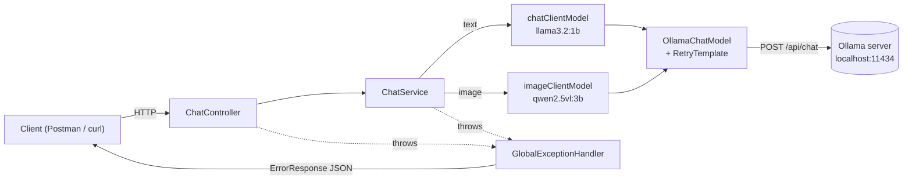
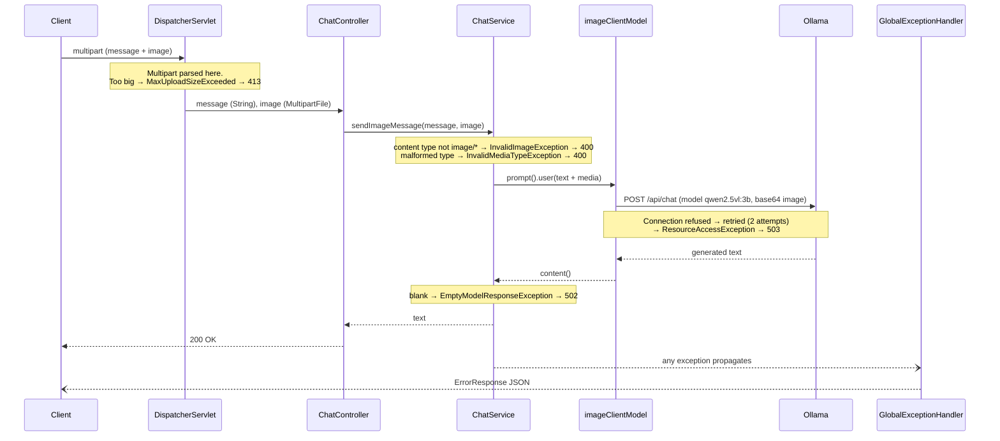

# Spring AI + Ollama: Local Multi-Model Chat API

A Spring Boot REST API that talks to LLMs running **locally** through **Spring AI** and **Ollama**.
Text chat goes to one model (`llama3.2:1b`), questions about images go to a vision model (`qwen2.5vl:3b`), and every failure comes back in one consistent JSON error format.

> **This README is also a study guide.** It covers *how* to run the project and *why* each piece is built the way it is. Section 11 is a self-quiz for quick revision.

---

## Table of contents

1. [What this project does](#1-what-this-project-does)
2. [Architecture and request flow](#2-architecture-and-request-flow)
3. [Project structure](#3-project-structure)
4. [Getting started, step by step](#4-getting-started-step-by-step)
5. [Configuration explained](#5-configuration-explained)
6. [Code walkthrough](#6-code-walkthrough)
7. [API reference](#7-api-reference)
8. [Error handling: the full picture](#8-error-handling-the-full-picture)
9. [Multi-model design](#9-multi-model-design)
10. [Known limitations and next steps](#10-known-limitations-and-next-steps)
11. [Revision checklist (self-quiz)](#11-revision-checklist-self-quiz)

---

## 1. What this project does

| Endpoint | Input | Model used | Output |
|---|---|---|---|
| `POST /chat` | Raw text body | `llama3.2:1b` | Full reply as plain text |
| `POST /chat/stream` | Raw text body | `llama3.2:1b` | Reply streamed as it is generated |
| `POST /chat/image` | Multipart form: `message` (text) + `image` (file) | `qwen2.5vl:3b` | Answer about the image as plain text |

Everything runs on your own machine. There are no API keys and no cloud calls. Spring AI talks to Ollama's HTTP API at `http://localhost:11434`.

---

## 2. Architecture and request flow



### Layer responsibilities

| Layer | Class | Does | Does **not** |
|---|---|---|---|
| Web | `ChatController` | Maps HTTP to Java and returns `ResponseEntity` | Validate, catch exceptions, or know about models |
| Business | `ChatService` | Validates input, picks the right model client, guards against empty output | Build HTTP responses |
| Config | `ChatClientConfig` | Creates one `ChatClient` per model | Hold any request logic |
| Cross-cutting | `GlobalExceptionHandler` | Turns any exception into a status code plus an `ErrorResponse` | Run on success paths |

### 2.1 Lifecycle of a text request (`POST /chat`)

1. Tomcat receives the request. `DispatcherServlet` routes it to `ChatController.sendChatMessage`.
2. `@RequestBody String` binds the raw body text.
3. The controller calls `ChatService.sendChatMessage`.
4. The service calls `chatClientModel.prompt().user(message).call().content()`.
5. `ChatClient` hands the call to `OllamaChatModel`. That model wraps the call in a **`RetryTemplate`** and sends `POST http://localhost:11434/api/chat` with `model: llama3.2:1b`.
6. Ollama loads the model if it isn't loaded yet, generates a reply, and returns it.
7. `.content()` extracts the text. `requireContent(...)` throws if the text is null or blank.
8. The controller returns `200 OK` with the text.

### 2.2 Lifecycle of an image request (`POST /chat/image`)



**Key insight:** the multipart size check happens **before** your controller method runs. No `try/catch` inside the controller can see it. Only the `@RestControllerAdvice`, which sits around the whole dispatch, can.

---

## 3. Project structure

```
spring-ai/
├── build.gradle                    # Dependencies, Java 25 toolchain, Spring AI BOM
├── settings.gradle                 # Project name
├── gradlew / gradlew.bat           # Gradle wrapper scripts (no local Gradle install needed)
├── gradle/wrapper/                 # Wrapper jar + properties (committed on purpose)
├── .gitignore                      # Ignores build/, .gradle/, .idea/, HELP.md, ...
└── src/
    ├── main/
    │   ├── java/com/akshat/spring_ai/
    │   │   ├── SpringAiApplication.java            # Entry point (@SpringBootApplication)
    │   │   ├── config/
    │   │   │   └── ChatClientConfig.java           # Two ChatClient beans, one per model
    │   │   ├── controller/
    │   │   │   └── ChatController.java             # /chat, /chat/stream, /chat/image
    │   │   ├── service/
    │   │   │   └── ChatService.java                # Validation, model routing, empty-output guard
    │   │   └── exception/
    │   │       ├── GlobalExceptionHandler.java     # @RestControllerAdvice: exception → status + JSON
    │   │       ├── custom/
    │   │       │   ├── InvalidImageException.java        # → 400
    │   │       │   └── EmptyModelResponseException.java  # → 502
    │   │       └── dto/
    │   │           └── ErrorResponse.java          # record: timestamp, status, error, message, path
    │   └── resources/
    │       └── application.yaml                    # Upload limits, retry, model names
    └── test/java/com/akshat/spring_ai/
        └── SpringAiApplicationTests.java           # contextLoads smoke test
```

This is **package-by-layer** (controller / service / config / exception), the usual choice for a project this size. Package names are singular (`exception`, not `exceptions`), following the common Java convention.

---

## 4. Getting started, step by step

### 4.1 Make sure Ollama is running

Launch the Ollama desktop app (it lives in the system tray), then verify:

```bash
curl http://localhost:11434
```

You should see `Ollama is running`. If you get "connection refused", Ollama isn't running.

### 4.2 Pull the models

```bash
ollama pull llama3.2:1b
ollama pull qwen2.5vl:3b
ollama list
```

### 4.3 Smoke-test the models directly, without Spring

If something fails here, it's an Ollama, model, or hardware problem, and **no Spring change can fix it**. This one test saves hours.

```bash
ollama run llama3.2:1b
```

Ask it something and confirm you get a full reply. Then exit with `/bye`.

```bash
ollama run qwen2.5vl:3b
```

At the prompt, type `describe the image "C:\path\to\small-screenshot.png"`. Use a **small** image, such as a screenshot. Large photos can overflow the model's context window.

### 4.4 Run the app

```bash
./gradlew bootRun
```

On Windows PowerShell, use `.\gradlew.bat bootRun` instead. Or run `SpringAiApplication` from IntelliJ.

Wait for `Tomcat started on port 8080`. The app does **not** call Ollama at startup, so it boots even if Ollama is down. Requests will fail with 503 until Ollama is up.

### 4.5 Send your first requests

```bash
curl -X POST http://localhost:8080/chat -H "Content-Type: text/plain" -d "Explain a Spring bean in two lines"
```

```bash
curl -X POST http://localhost:8080/chat/image -F "message=Describe this image" -F "image=@C:/path/to/small.png;type=image/png"
```

Section 7 has full details, Postman steps, and error examples for every endpoint.

---

## 5. Configuration explained

[`src/main/resources/application.yaml`](src/main/resources/application.yaml):

```yaml
spring:
  application:
    name: spring-ai
  servlet:
    multipart:
      max-file-size: 40MB
      max-request-size: 40MB
  ai:
#    ollama:
#      chat:
#        model: llama3.2:1b        # This can be used only for a single model setup.
    retry:
      max-attempts: 2
      backoff:
        initial-interval: 1s
        multiplier: 2
        max-interval: 5s

app:
  ai:
    model:
      chat: llama3.2:1b
      image: qwen2.5vl:3b
```

| Key | What it does | Why this value |
|---|---|---|
| `servlet.multipart.max-file-size` | Largest allowed **single part**, such as the image | The default is **1 MB**. Phone photos are bigger, so the default produced `MaxUploadSizeExceededException`. |
| `servlet.multipart.max-request-size` | Largest allowed **whole request** (all parts) | The default is 10 MB. Keep it ≥ `max-file-size`, because the request also carries the message part. |
| `ai.retry.max-attempts` | How many times Spring AI tries a failed model call | The default is **10, with exponential backoff**. That made requests look "stuck" for minutes while Ollama was down. 2 gives one quick retry before failing with 503. |
| `ai.retry.backoff.*` | Wait between retries: 1s, doubling, capped at 5s | Keeps failures fast |
| `ai.ollama.chat.model` (commented out) | Default model baked into the auto-configured `OllamaChatModel` | Only needed for a **single-model** setup. Both clients here set their own model, so it's unused. The app was verified to work with it commented out. |
| `app.ai.model.chat` / `.image` | **Our own** property namespace (not Spring's), read with `@Value` | Lets you swap models without touching code |

Defaults you don't see but rely on:

| Property | Default | Meaning |
|---|---|---|
| `spring.ai.ollama.base-url` | `http://localhost:11434` | Where Spring AI sends `/api/chat` |
| `server.port` | `8080` | Where the API listens |

**When the commented-out fallback *would* matter:** only if some code injected the raw auto-configured `ChatClient.Builder` or `OllamaChatModel` and called it **without** setting a model. That call would have no model and would fail at request time. Nothing in this project does that.

---

## 6. Code walkthrough

### 6.1 `SpringAiApplication`

A standard entry point. `@SpringBootApplication` = `@Configuration` + `@EnableAutoConfiguration` + `@ComponentScan` of `com.akshat.spring_ai` and its sub-packages. That's why the controller, service, config, and exception handler are all found automatically.

### 6.2 `ChatClientConfig`: one client per model

[`config/ChatClientConfig.java`](src/main/java/com/akshat/spring_ai/config/ChatClientConfig.java)

```java
@Bean
public ChatClient chatClientModel(ChatClient.Builder builder, @Value("${app.ai.model.chat}") String chatModel) {
    return builder.defaultOptions(OllamaChatOptions.builder().model(chatModel)).build();
}

@Bean
public ChatClient imageClientModel(ChatClient.Builder builder, @Value("${app.ai.model.image}") String imageModel) {
    return builder.defaultOptions(OllamaChatOptions.builder().model(imageModel)).build();
}
```

What to understand:

- **Spring AI auto-configures** two beans for you: an `OllamaChatModel`, which does the actual HTTP calls to Ollama, and a `ChatClient.Builder`. You only build `ChatClient`s on top of them.
- **`ChatClient.Builder` is prototype-scoped.** Every injection point gets a *fresh* builder. So the two `@Bean` methods receive different builders, and setting `llama3.2:1b` on one never affects the other.
- **In Spring AI 2.x, `defaultOptions(...)` takes a `ChatOptions.Builder`, not a built options object.** The real signature, checked in the 2.0.1 jar with `javap`, is:
  ```
  ChatClient.Builder defaultOptions(ChatOptions.Builder)
  ```
  So you pass `OllamaChatOptions.builder().model(x)` **without** `.build()`. Adding `.build()` there is a compile error. Many tutorials show `.build()`, but they're written for Spring AI 1.x. The per-request `.options(...)` method on a prompt also takes a builder in 2.x (see §9.4).
- **`OllamaChatOptions` is the current class.** The older `OllamaOptions` is deprecated in 2.x.
- **Bean names come from method names:** `chatClientModel` and `imageClientModel`. These names matter for injection (§6.3).
- **`@Value("${app.ai.model.chat}")`** injects the model name from `application.yaml`, so the model isn't hardcoded.

### 6.3 `ChatService`: validation, routing, guarding

[`service/ChatService.java`](src/main/java/com/akshat/spring_ai/service/ChatService.java)

```java
@Service
@RequiredArgsConstructor
public class ChatService {
    private final ChatClient chatClientModel;   // → bean "chatClientModel" (llama3.2:1b)
    private final ChatClient imageClientModel;  // → bean "imageClientModel" (qwen2.5vl:3b)
    ...
}
```

**How Spring knows which `ChatClient` goes where:**
1. There are two beans of type `ChatClient`, so injection by type alone is ambiguous.
2. Spring then **matches the constructor parameter name to a bean name**.
3. Lombok's `@RequiredArgsConstructor` generates the constructor using the **field names** as parameter names.
4. Spring Boot's Gradle plugin compiles with `-parameters`, so those names exist at runtime.
5. Result: `chatClientModel` → bean `chatClientModel`, and `imageClientModel` → bean `imageClientModel`.

> ⚠️ If you rename a field so it no longer matches a bean name, startup fails with `NoUniqueBeanDefinitionException`. The explicit alternative is `@Qualifier("imageClientModel")`. With Lombok, that also needs `lombok.config` → `lombok.copyableAnnotations += org.springframework.beans.factory.annotation.Qualifier`, or a hand-written constructor.

**`requireContent` (the empty-output guard):**

```java
private String requireContent(String content) {
    if (content == null || content.isBlank()) {
        throw new EmptyModelResponseException("Model returned no content");
    }
    return content;
}
```

- It sits in **one place**, used by both the text and image methods.
- It handles `null` as well as blank strings. The original `result.isBlank()` in the controller would have thrown an NPE on `null`.
- **Why it's a private method, not a util class:** only one class uses it. Extracting a helper with a single caller is premature abstraction (YAGNI). When a second class needs it, there are two options:
  - **Static util** in a `util/` package: a `final` class with a private constructor and `static` methods, called through a static import. Good for pure, stateless logic.
  - **`@Component`**: inject it instead. Use this when you need to mock it in tests, configure it, or swap implementations. A static util can't be overridden or injected, so it's *less* extensible than it sounds.

**`call()` vs `stream()`:**
- `.call().content()` blocks until the whole reply is ready and returns a `String`.
- `.stream().content()` returns a `Flux<String>` that emits chunks of text as the model generates them.

**Image handling:**

```java
String contentType = image.getContentType();
if (contentType == null || !contentType.startsWith("image/")) {
    throw new InvalidImageException("Invalid image type: " + contentType);
}
imageClientModel.prompt()
        .user(prompt -> prompt.text(message)
                .media(MediaType.parseMediaType(contentType), new InputStreamResource(image)))
        .call().content();
```

- `getContentType()` returns whatever **the client declared** for that part. Postman sometimes sends `application/octet-stream` for a PNG, and the validation then rejects it.
- `.media(MimeType, Resource)` attaches the image to the user message. Spring AI encodes it and sends it to Ollama.
- `MediaType.parseMediaType` throws `InvalidMediaTypeException` for malformed values. That exception **extends `IllegalArgumentException`**, which is why the `IllegalArgumentException` handler still matters.
- **More robust option:** check the type from the actual file bytes instead of trusting the client, for example with `URLConnection.guessContentTypeFromStream(image.getInputStream())` or Apache Tika.

### 6.4 `ChatController`: kept deliberately thin

[`controller/ChatController.java`](src/main/java/com/akshat/spring_ai/controller/ChatController.java)

```java
@PostMapping("/image")
public ResponseEntity<String> sendImageMessage(@RequestPart String message, @RequestPart MultipartFile image) {
    String result = chatService.sendImageMessage(message, image);
    return ResponseEntity.ok(result);
}
```

- **No `try/catch`.** An earlier version caught exceptions locally. That (a) stopped exceptions from ever reaching the global handler, and (b) returned plain-text errors while other endpoints returned JSON. With a `@RestControllerAdvice` in place, controllers should just let exceptions propagate.
- **`@RequestBody String`**: the whole request body becomes the string. Send it with `Content-Type: text/plain`.
- **`@RequestPart`**: binds one part of a `multipart/form-data` request. `message` is a plain-text form field and `image` is the file. (`@RequestParam` would also work for the plain text field.)
- **If `message` ever needs more than one field** (for example `{ "message": "...", "temperature": 0.7 }`), make it a JSON part bound to a record DTO with `@RequestPart ChatRequest message`. The client must then set that part's `Content-Type` to `application/json`, or Spring can't convert it. For a single string, plain text is simpler and correct.
- **`Flux<String>` in MVC:** Spring MVC supports reactive return types, and Reactor is on the classpath via Spring AI. To receive tokens as they're generated, request with `Accept: text/event-stream`. Adding `produces = MediaType.TEXT_EVENT_STREAM_VALUE` to the mapping makes that explicit.

### 6.5 The `exception` package

#### `ErrorResponse`: a record with a default timestamp

[`exception/dto/ErrorResponse.java`](src/main/java/com/akshat/spring_ai/exception/dto/ErrorResponse.java)

```java
public record ErrorResponse(LocalDateTime timestamp, int status, String error, String message, String path) {
    public ErrorResponse(int status, String error, String message, String path) {
        this(LocalDateTime.now(), status, error, message, path);
    }
}
```

Record rules worth remembering:
- Components go **in the header parentheses**. You don't declare fields in the body. Java generates the private final fields, the canonical constructor, the accessors (`status()`, not `getStatus()`), `equals`, `hashCode`, and `toString`.
- Records are **immutable**, which is ideal for a response DTO.
- To get a **default value**, add a secondary constructor that leaves out that component and **delegates with `this(...)`** to the canonical constructor. A secondary constructor in a record *must* end up calling the canonical one.
- The alternative is a static factory, `ErrorResponse.of(...)`. Either is idiomatic; this project uses the constructor.

Choosing the time type:

| Type | Example | Time zone info? | Use when |
|---|---|---|---|
| `LocalDateTime` (used here) | `2026-09-02T00:44:13.37` | ❌ none | Simple, readable, local-only apps |
| `Instant` | `2026-09-01T19:14:13Z` | UTC | Machine timestamps |
| `OffsetDateTime` | `2026-09-02T00:44:13+05:30` | ✅ offset | Public APIs: readable **and** unambiguous |

The fields mirror Spring Boot's own default error body (`timestamp, status, error, message, path`), so the shape looks familiar to anyone reading it.

#### Custom exceptions

```java
public class InvalidImageException extends RuntimeException { ... }        // → 400
public class EmptyModelResponseException extends RuntimeException { ... }  // → 502
```

- They extend **`RuntimeException`** (unchecked), which is standard for web and validation errors in Spring.
- **Why not just throw `IllegalArgumentException`?** Many libraries throw it for their own internal reasons. If you map *every* `IllegalArgumentException` to 400, a real server bug deep inside a library shows up as "Bad Request". A domain-specific exception maps only *your* case.

#### `GlobalExceptionHandler`

[`exception/GlobalExceptionHandler.java`](src/main/java/com/akshat/spring_ai/exception/GlobalExceptionHandler.java). See §8 for the full mapping table. The pattern for each handler:

```java
@ExceptionHandler(InvalidImageException.class)
public ResponseEntity<ErrorResponse> handleInvalidImageException(InvalidImageException ex,
                                                                 HttpServletRequest request) {
    log.warn(ex.getMessage(), ex);
    HttpStatus status = HttpStatus.BAD_REQUEST;
    ErrorResponse errorResponse = new ErrorResponse(status.value(), status.getReasonPhrase(),
            ex.getMessage(), request.getRequestURI());
    return new ResponseEntity<>(errorResponse, status);
}
```

| Field | Source | Example |
|---|---|---|
| `status` | `status.value()` | `400` |
| `error` | `status.getReasonPhrase()`, derived from the status so it can't mismatch | `"Bad Request"` |
| `message` | `ex.getMessage()` for 4xx, a generic text for most 5xx | `"Invalid image type: text/plain"` |
| `path` | `request.getRequestURI()` from the injected `HttpServletRequest` | `"/chat/image"` |

- The `@ExceptionHandler` annotation type and the **method parameter type must match**. An earlier bug annotated `IllegalArgumentException` but declared a `BadRequestException` parameter (a Tomcat-internal class from `org.apache.coyote`). That fails at runtime.
- `HttpServletRequest` is one of the arguments Spring injects automatically into handler methods.
- `HttpStatus.CONTENT_TOO_LARGE` is the current name for 413. It replaced `PAYLOAD_TOO_LARGE` to follow RFC 9110, and it's available in Spring 7.
- **IntelliJ shows "no usages" on these methods.** That's a false positive: Spring calls them through **reflection**, so there's no call site in your code. IntelliJ Ultimate's Spring support understands this. In Community edition, add `org.springframework.web.bind.annotation.ExceptionHandler` as an entry point under *Settings → Editor → Inspections → Java → Declaration redundancy → Unused declaration → Entry points → Annotations*. Don't delete the methods.

---

## 7. API reference

Base URL: `http://localhost:8080`

### 7.1 `POST /chat`: text chat (llama3.2:1b)

| | |
|---|---|
| Body | Raw text |
| Header | `Content-Type: text/plain` |
| Success | `200 OK`, plain-text reply |

```bash
curl -X POST http://localhost:8080/chat -H "Content-Type: text/plain" -d "What is dependency injection?"
```

**Postman:** POST → Body → **raw** → Text → type your message.

### 7.2 `POST /chat/stream`: streamed text chat (llama3.2:1b)

```bash
curl -N -X POST http://localhost:8080/chat/stream -H "Content-Type: text/plain" -H "Accept: text/event-stream" -d "Write a haiku about Java"
```

`-N` turns off curl's buffering so you can watch the text arrive in chunks.

### 7.3 `POST /chat/image`: ask about an image (qwen2.5vl:3b)

| Part | Type | Example |
|---|---|---|
| `message` | text | `Describe this image` |
| `image` | file, **with an `image/*` content type** | `photo.png` as `image/png` |

```bash
curl -X POST http://localhost:8080/chat/image -F "message=Describe this image" -F "image=@C:/path/to/small.png;type=image/png"
```

**Postman:**
1. Body → **form-data**
2. Row `message`: type **Text**, value = your question
3. Row `image`: type **File**, then pick the file
4. Click the **`…`** at the top right of the table and enable the **Content-Type** column. Set the image row to `image/png` or `image/jpeg`. Otherwise Postman may send `application/octet-stream`, and you'll get a 400.

**Use small images** (screenshots, or ≤ ~1280 px on the long side). Large photos can fill the model's context window and produce cut-off or garbled answers.

### 7.4 Error response format (every endpoint)

```json
{
  "timestamp": "2026-09-02T00:44:13.3702619",
  "status": 400,
  "error": "Bad Request",
  "message": "Invalid image type: application/octet-stream",
  "path": "/chat/image"
}
```

### 7.5 Status codes and how to trigger each one

| Status | Exception | Typical cause | How to reproduce it |
|---|---|---|---|
| 400 | `InvalidImageException` | Image part isn't `image/*` | Send a `.txt` file as `image` |
| 400 | `IllegalArgumentException` (incl. `InvalidMediaTypeException`) | Malformed content type | Set the part type to something like `image/` |
| 413 | `MaxUploadSizeExceededException` | File larger than `max-file-size` | Temporarily set `max-file-size: 1KB` and upload anything |
| 502 | `EmptyModelResponseException` | Model returned blank output | Hard to force by hand. Test it with a mocked `ChatService`. |
| 503 | `ResourceAccessException` | Ollama unreachable | Quit Ollama, then call `/chat` |
| 500 | Any other `Exception` | Anything unexpected | The catch-all, with no clean manual trigger |

---

## 8. Error handling: the full picture

### Why a global handler instead of try/catch everywhere

| Local `try/catch` in each controller | `@RestControllerAdvice` (used here) |
|---|---|
| Duplicated in every endpoint | Written once |
| Error formats drift apart (plain text in one place, JSON in another) | One `ErrorResponse` everywhere |
| **Can't see** exceptions thrown before the method runs (multipart size) | Wraps the whole dispatch, so it sees them |
| Controllers fill up with error code | Controllers stay thin |

### How Spring picks a handler

When an exception escapes, Spring looks for the **most specific** matching `@ExceptionHandler`. `InvalidImageException` goes to its own handler, not to `Exception`. The `Exception` handler is the safety net for everything else. The order of methods in the file doesn't matter. Specificity decides.

### The 4xx vs 5xx policy

| | 4xx (client's fault) | 5xx (server's fault) |
|---|---|---|
| `message` to the client | The real message, which helps them fix the request | **Generic** `"Something went wrong"`, so internals don't leak |
| Log level | `warn` | `error`, with the stack trace |
| Example of a leak avoided | — | `ResourceAccessException` would expose `"Connection refused: localhost/127.0.0.1:11434"`, which is internal infrastructure |
| Exception | — | `502` returns its message because `"Model returned no content"` is safe and useful |

### What the global handler can't catch

- **Errors in the middle of `/chat/stream`.** By the time a `Flux` fails, the 200 response may already be streaming, so the advice can't swap in an `ErrorResponse`. Handle these on the stream itself, for example with `.onErrorResume(e -> Flux.just("Failed to chat with model"))`.

---

## 9. Multi-model design

### 9.1 Goal

| Use case | Model | Why |
|---|---|---|
| Text chat | `llama3.2:1b` | Small and fast, and fits easily in 4 GB VRAM |
| Images | `qwen2.5vl:3b` | Vision-capable, good at reading text and charts, and fits mostly on a 4 GB GPU |

### 9.2 The pattern

1. Name the models in config (`app.ai.model.chat` / `app.ai.model.image`).
2. Create **one `ChatClient` bean per model**, each with `defaultOptions(OllamaChatOptions.builder().model(...))`.
3. Inject both into the service and call the right one per method.

Both clients share **one** `OllamaChatModel`, which means one connection to Ollama. Only the model name sent with each request differs. You can confirm which model served a request with `ollama ps` during the request, or in the Ollama server log (`model=...qwen2.5vl:3b`).

### 9.3 Adding a third model

1. Pull it: `ollama pull <model>`
2. Add `app.ai.model.<name>: <model>` to the YAML.
3. Add a `@Bean public ChatClient <name>ClientModel(...)` in `ChatClientConfig`.
4. Add a matching `private final ChatClient <name>ClientModel;` field in the service.

### 9.4 Per-request overrides

Defaults apply to every call from that client. For a single request, you can override options. This also takes a **builder** in 2.x:

```java
imageClientModel.prompt()
        .options(OllamaChatOptions.builder().numCtx(8192).numPredict(1024))
        .user(...)
        .call().content();
```

`numCtx` raises the context window (the total token budget for input plus output) and `numPredict` caps the output length.

---

## 10. Known limitations and next steps

| Area | Now | Improvement |
|---|---|---|
| Large images | Sent as-is, so they can overflow the context | Downscale on the server (e.g. `ImageIO`, long edge ≤ 1280 px) before calling the model |
| Image type check | Trusts the client's header | Check the actual bytes (`URLConnection.guessContentTypeFromStream`, Apache Tika) |
| `/chat/stream` errors | Not covered by the advice | `.onErrorResume(...)` on the `Flux` |
| 4xx logging | Logs with stack traces | `log.warn("...: {}", ex.getMessage())` without the exception object |
| Model options | Only the model name is set | Per-client `numCtx` / `numPredict` / `temperature` (they take builders in 2.x) |
| Tests | Only `contextLoads` | MockMvc tests for every status |
| Security | None (local dev only) | Auth, rate limiting, CORS if ever exposed |

---

## 11. Revision checklist (self-quiz)

Cover the answers and test yourself.

1. **Why does the app need two `ChatClient` beans?** One per model. Each sets a different default model through `defaultOptions`.
2. **How does Spring choose between two `ChatClient` beans with no `@Qualifier`?** It matches the constructor parameter name to a bean name. Lombok uses field names as parameter names, and `-parameters` keeps them at runtime.
3. **Why can two `@Bean` methods both inject `ChatClient.Builder` safely?** It's prototype-scoped, so each injection gets a fresh builder.
4. **What does `defaultOptions` accept in Spring AI 2.x?** A `ChatOptions.Builder`. Don't call `.build()` on the options.
5. **Which options class is current?** `OllamaChatOptions`. `OllamaOptions` is deprecated.
6. **What does the commented-out `spring.ai.ollama.chat.model` do?** It sets the default model for a single-model setup. It's unused here because both clients set their own.
7. **Why remove the try/catch from the controller?** It caught exceptions before the global handler could, and it returned inconsistent plain-text errors.
8. **Can a try/catch in the controller catch `MaxUploadSizeExceededException`?** No. It's thrown during multipart parsing, before the method runs. Only the advice can.
9. **Why use custom exceptions instead of `IllegalArgumentException`?** Libraries throw IAE too, and mapping all of them to 400 hides real server bugs.
10. **Why keep the `IllegalArgumentException` handler anyway?** `MediaType.parseMediaType` throws `InvalidMediaTypeException`, which extends IAE.
11. **Why do 5xx responses use a generic message?** To avoid leaking internals such as hosts, ports, and stack details. The real error is logged.
12. **How do you set a default value in a record?** A secondary constructor that delegates with `this(...)` to the canonical constructor.
13. **Where does `path` in `ErrorResponse` come from?** `request.getRequestURI()` on the injected `HttpServletRequest`.
14. **Why is 413 `CONTENT_TOO_LARGE` and not `PAYLOAD_TOO_LARGE`?** RFC 9110 renamed it, and Spring 6.1+ / 7 uses the new name.
15. **Why did a request hang when Ollama was off?** Spring AI retried with exponential backoff (10 attempts by default).
16. **Why does IntelliJ say handler methods are unused?** Spring calls them through reflection. It's a false positive.
17. **What's the difference between `.call()` and `.stream()`?** A blocking full `String` vs. a `Flux<String>` of chunks.
